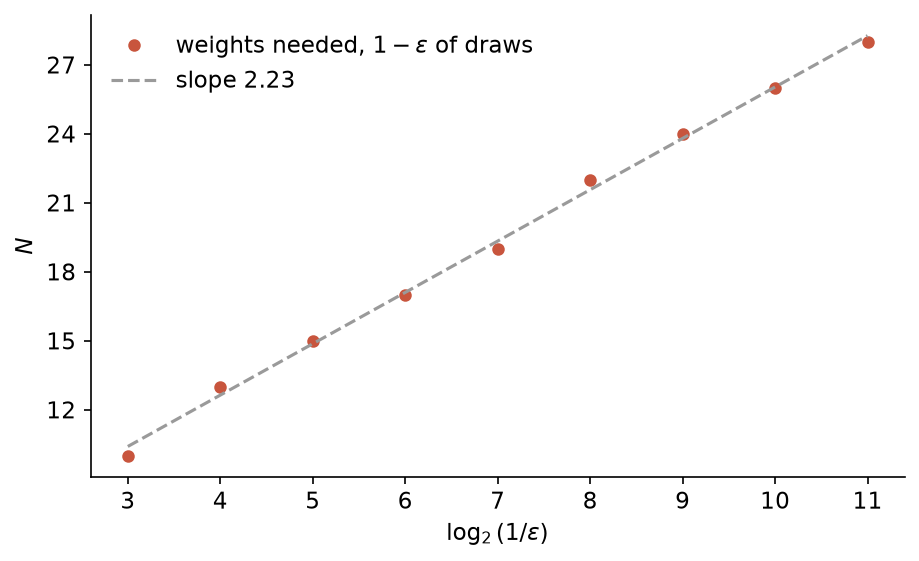
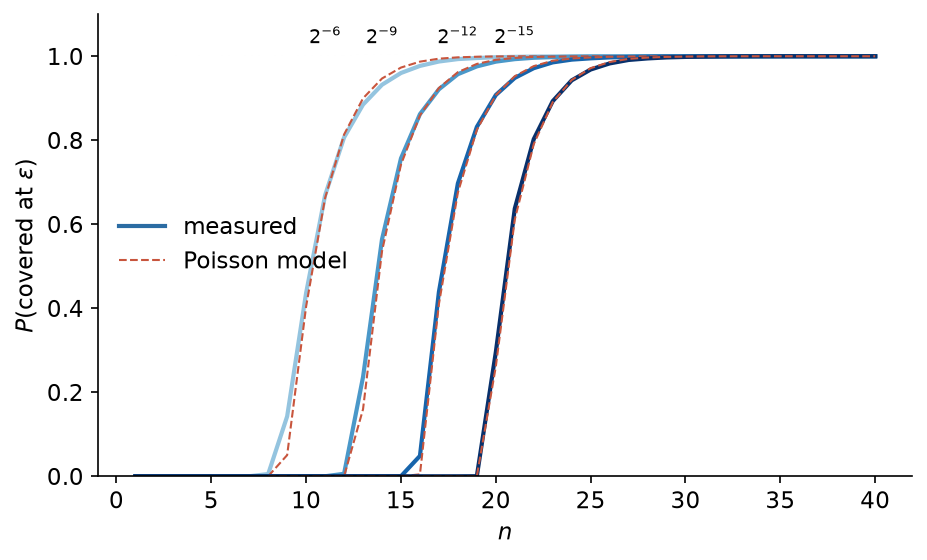

# subset-sum-tickets

How many random numbers do you need so that, by picking which ones to add up, you can get within $\varepsilon$ of any number in $[-1, 1]$? A lemma by Lueker says about $C \ln(1/\varepsilon)$, but I couldn't find a value for $C$ anywhere, so I measured it.

## In plain words

A neural network is a big list of numbers (its weights), and training it means adjusting those numbers until it does what you want.

It turns out you can skip the training: take a large network filled with random numbers, delete the right ones, and what is left works, with every remaining number exactly as it was drawn. This has been proved.

The reason it can work is easier to see with coins. Say you have a bag of coins with random weights and you need exactly 0.37 g on a scale. You can't file the coins down, you can only choose which ones go on the scale. With 2 coins there are 4 possible combinations and you will probably miss. With 20 coins there are about a million, and one of them will be very close to 0.37 g, whatever the target. Deleting weights in the network is the same as choosing coins.

Each extra coin doubles the number of combinations, so you don't need many: being 10 times more precise only costs a few more coins. The math says the number of coins grows like $C$ times the number of digits of precision you want. The proofs don't say what $C$ is, and the only explicit value I found is $C = 1536$.

I simulated it. $C$ is about 3.7 at a precision of $2^{-11}$ (roughly 1/2000) and still going down slowly. A heuristic argument, which I partly check numerically, says it should end up around 2.9. So in practice a random network needs far fewer extra weights than the proofs ask for.

The rest goes through this in more detail.

## Lottery tickets

The lottery ticket hypothesis (Frankle and Carbin, 2019) says that a large network contains a much smaller subnetwork that, trained alone from the same starting weights, does as well as the full one. You find it by training, deleting the smallest weights, resetting the others to their initial values, and training again.

The strong version goes further. In a big enough random network you don't need to train at all: deleting the right weights is enough, and the weights you keep stay at their random initial values. Malach et al. (2020) and Pensia et al. (2020) proved it.

The proof builds the target network one weight at a time. If the target needs a weight $w = 0.37$, the random network gets many paths in its place, each carrying a random value $x_i$, and you keep only some of them, so that

$$w \approx \sum_{i \in S} x_i.$$

How many paths you need per weight is how much bigger the random network has to be.

## The lemma

Lueker (1998): let $X_1, \dots, X_n$ be independent and uniform on $[-1, 1]$. There is a constant $C$ such that if $n \geq C \ln(1/\varepsilon)$, then with probability at least $1 - \varepsilon$, every $z \in [-1, 1]$ is within $\varepsilon$ of some subset sum $\sum_{i \in S} X_i$.

The proof only shows that some $C$ works. A simple counting argument gives a lower bound: $n$ numbers have at most $2^n$ subset sums, and leaving no gap wider than $2\varepsilon$ in an interval of length 2 takes about $1/\varepsilon$ of them. So $2^n \gtrsim 1/\varepsilon$, which means $n \gtrsim \log_2(1/\varepsilon) \approx 1.44 \ln(1/\varepsilon)$. In practice it takes more, because the sums pile up in the middle and leave gaps.

## What I measured

For a draw of weights $x_1, x_2, \dots$, the covering radius $\rho_n$ is the worst error over $[-1, 1]$ when using the first $n$ weights:

$$\rho_n = \max_{z \in [-1, 1]} \ \min_{S \subseteq \{1, \dots, n\}} \Big| z - \sum_{i \in S} x_i \Big|.$$

It can be computed exactly by sorting the subset sums and looking at the largest gap. I write $N(\varepsilon)$ for the first $n$ with $\rho_n \leq \varepsilon$, i.e. how many weights that draw needed.

I did 20000 draws of 40 weights and looked at the median of $N(\varepsilon)$ (a typical draw) and at its $1 - \varepsilon$ quantile (enough weights that only a fraction $\varepsilon$ of draws fail, which is what the lemma asks for). The constant is then $C = N / \ln(1/\varepsilon)$.

With 40 weights there are $2^{40}$ sums, too many to list. Instead the weights are drawn on a grid of step $2^{-20}$, the reachable sums are kept as a bit array on that grid, and sums that can no longer come back to $[-1, 1]$ are dropped. This is exact down to $\varepsilon \approx 2^{-16}$. The $1 - \varepsilon$ quantile needs a few failing draws to be estimated, so with 20000 draws I stop it at $2^{-11}$.

## Results

| $\varepsilon$ | median $N$ | $N$ at $1 - \varepsilon$ | $C$ |
|---|---|---|---|
| $2^{-3}$ | 7 | 10 | 4.81 |
| $2^{-4}$ | 8 | 13 | 4.69 |
| $2^{-5}$ | 10 | 15 | 4.33 |
| $2^{-6}$ | 11 | 17 | 4.09 |
| $2^{-7}$ | 12 | 19 | 3.92 |
| $2^{-8}$ | 13 | 22 | 3.97 |
| $2^{-9}$ | 14 | 24 | 3.85 |
| $2^{-10}$ | 15 | 26 | 3.75 |
| $2^{-11}$ | 17 | 28 | 3.67 |

$C$ goes down slowly, from 4.81 at $2^{-3}$ to 3.67 at $2^{-11}$. Each time $\varepsilon$ is halved, the guarantee costs about 2.2 more weights (bootstrap 95% interval 2.15 to 2.42), against 1.2 for the median.



The slow draws are the ones whose weights lean to one side: the sums drift away from 0 and fewer of them land in $[-1, 1]$. The imbalance $t = |\sum_i x_i| / \sqrt{\sum_i x_i^2}$ has a rank correlation of 0.84 with $N$.

A model with nothing fitted, which treats the $2^n$ sums as random points with a Gaussian density, follows the measured curves within 9 percentage points. Below, each curve is the share of draws covered at a given precision as $n$ grows, measured (solid) and predicted by the model (dashed).



## Where $C$ goes

This is a heuristic, not a proof.

For a typical draw, the counting argument above gives about $\log_2(1/\varepsilon)$ weights, so $C \to 1/\ln 2 \approx 1.44$. The median grows by 1.2 per halving in the data, against 1 predicted.

The guarantee also has to cover the worst draws, the ones with a large imbalance $t$. Roughly, a fraction $\varepsilon$ of draws have $t^2/2 \gtrsim \ln(1/\varepsilon)$, and those have about $e^{-t^2/2} = \varepsilon$ times fewer sums near 0. Since each weight doubles the number of sums, making up for that costs another $\log_2(1/\varepsilon)$ weights, so $N \approx 2 \log_2(1/\varepsilon)$ and

$$C \to \frac{2}{\ln 2} \approx 2.89.$$

The notebook does the same argument with large deviations instead of the Gaussian shortcut. Its key step is the rate $\ln 2 \, (1 - a)$ at which unbalanced draws become rare, and computing that rate directly gives the same values to 4 decimals. What I can't check is the step from "enough sums near 0" to "no gap anywhere in $[-1, 1]$", since the $2^n$ sums come from only $n$ numbers and are far from independent.

The data shows the doubling (2.2 against 1.2 per halving), but the slope is a bit above 2. If it stayed at 2.23, $C$ would tend to $2.23 / \ln 2 \approx 3.2$ rather than 2.89. Lower-order terms could bring it down to 2 at finer precisions, and I can't tell from here. My best guess is that $C$ ends up somewhere around 3.

## Demo

I trained a logistic regression on scikit-learn's digits (96.81% test accuracy, mean over 5 splits), then replaced each of its weights, bias included, by a small pool of random weights, keeping the subset whose sum is closest. With pools of 12 or more, the rebuilt model matches the original on average. The original still had to be trained first, so this is compression by pruning, not learning from scratch.

## Limits

- The limit of $C$ is a prediction, and the data stops at $C = 3.67$.
- Results are exact down to $\varepsilon \approx 2^{-16}$, and the guarantee only goes to $2^{-11}$.
- The demo uses a linear model, not a deep network like in the theorems.
- The literature I found only has loose upper bounds. Lueker's proof gives no value, and the shorter proof by da Cunha et al. (2023) uses $C = 3 \times 512 = 1536$ (end of their Section 3). I didn't find a sharp value, a lower bound beyond counting, or $2/\ln 2$, but I didn't search exhaustively.

## Running it

```
pip install -r requirements.txt
python main.py    # 20000 draws of 40 weights, about 1 hour on 3 cores
jupyter notebook analysis.ipynb
pytest
```

## References

- Frankle, Carbin. The Lottery Ticket Hypothesis. ICLR 2019.
- Malach et al. Proving the Lottery Ticket Hypothesis: Pruning is All You Need. ICML 2020.
- Pensia et al. Optimal Lottery Tickets via Subset Sum. NeurIPS 2020.
- Lueker. Exponentially small bounds on the expected optimum of the partition and subset sum problems. Random Structures & Algorithms 12:51-62, 1998.
- da Cunha et al. Revisiting the Random Subset Sum Problem. ESA 2023.
